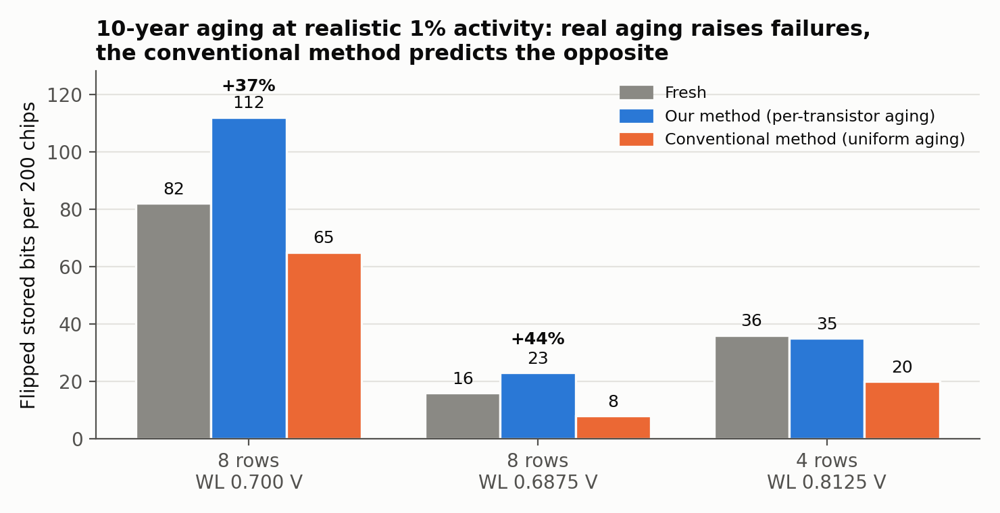
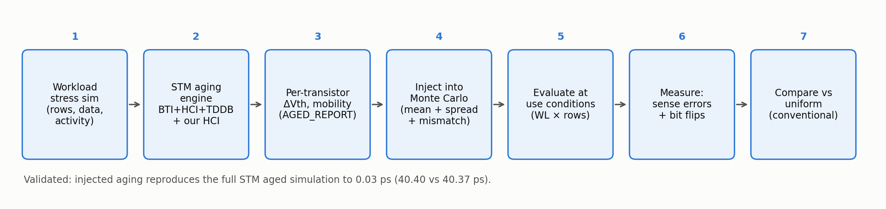
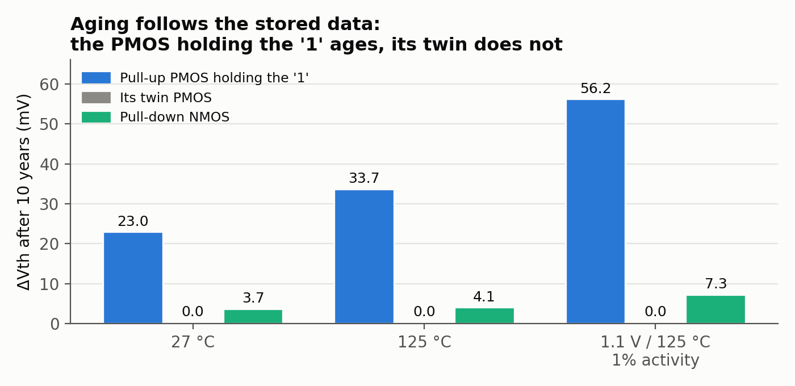
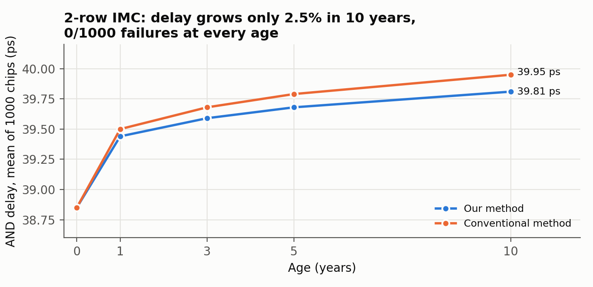
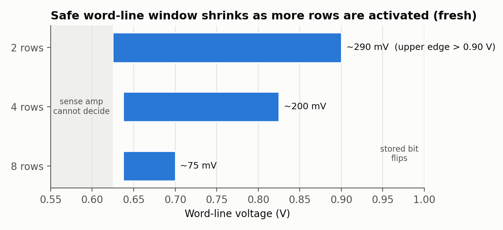
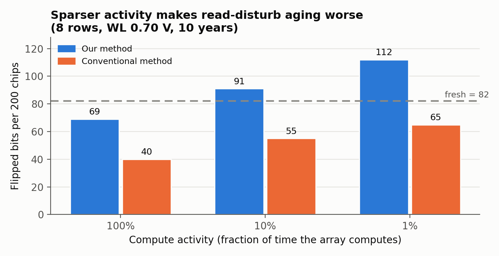
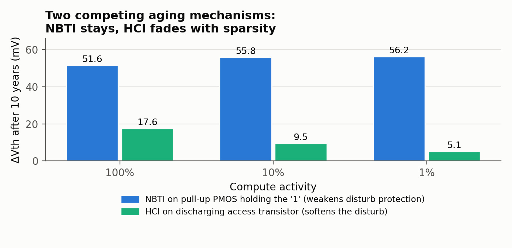
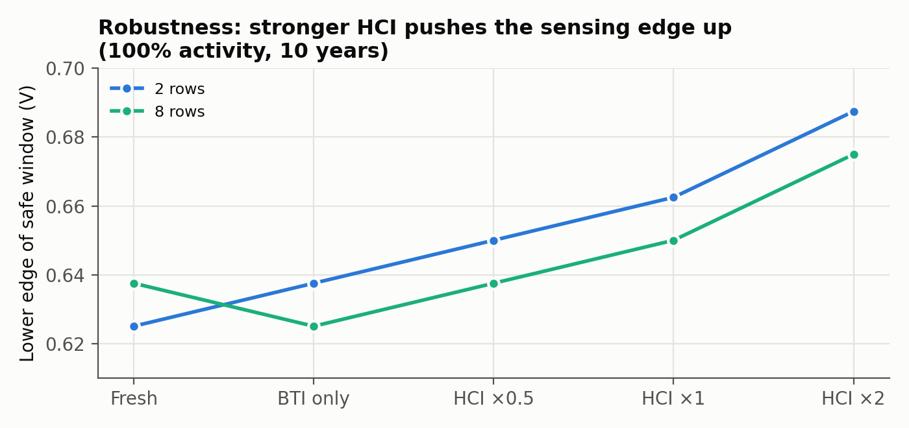
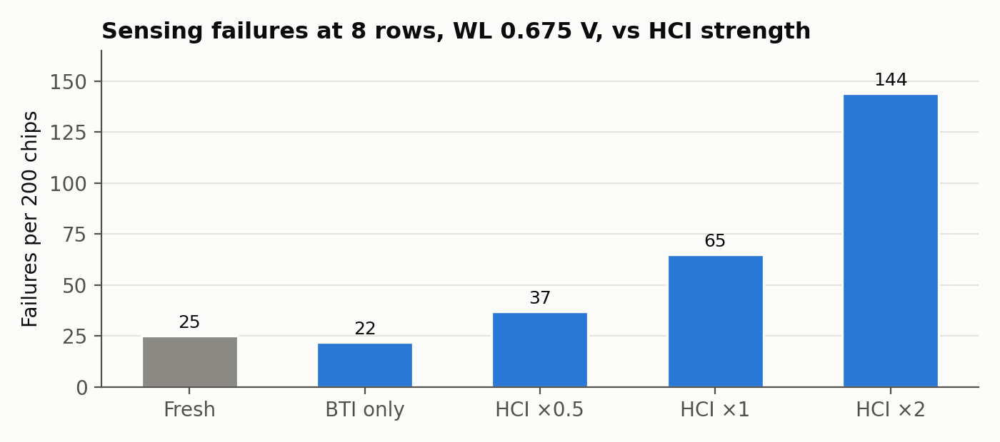
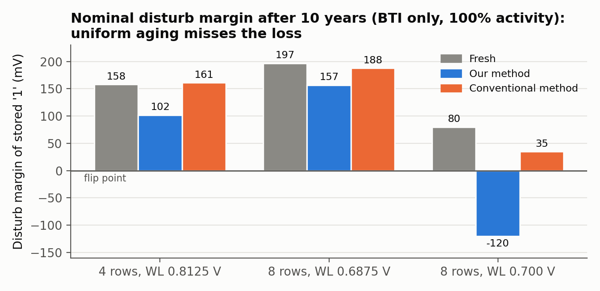

# Aging of SRAM In-Memory Computing under Neuromorphic Workloads (28 nm FD-SOI)

**Author:** Tushar Dudeja, Vellore Institute of Technology (VIT)
**Tools:** Cadence Spectre (APS), STMicroelectronics 28 nm FD-SOI foundry aging models, OCEAN / ViVA, Python

SRAM in-memory computing (IMC) performs logic or multiply-accumulate operations
inside the memory array by activating several rows at once and sensing the bitline.
The stored data, such as neural-network weights, stays in the array for years, so the
transistors age through bias-temperature instability (BTI), hot-carrier injection (HCI)
and oxide breakdown (TDDB).

Recent work characterizes this aging with one shared threshold-voltage shift for
every transistor, BTI only, and no notion of workload activity. This project asks
what happens when each transistor ages according to its *own* stress, under the
sparse activity typical of neuromorphic workloads.

> **Main finding.** At realistic sparse activity, 10-year aging **raises** read-disturb
> bit flips by **37 %** (82 → 112 per 200 chips), while the conventional
> uniform-aging method predicts the **opposite trend** and under-estimates failures by
> **1.7–2.9×**. It would sign off an unsafe design.

---

## The circuit

| Block | Details |
|---|---|
| Bit cell | 6T SRAM from STM's 0.120 µm² dense-cell devices |
| Array | 4 columns × N rows, with N = 2, 4 or 8 rows activated together (multi-operand AND/NOR) |
| Sense amplifier | StrongARM latch; AND senses BL vs a reference, NOR senses BLB |
| Periphery | mode bit (memory read vs logic), output latches; under-driven word lines (0.65–0.85 V) to limit read disturb |
| Operating point | 1.0 V, 1 GHz; stress at 1.1 V and 125 °C |

Verified: correct 6T write/read/hold, 24/24 correct AND/NOR outputs and a correct memory
read. AND delay is 38.85 ps (Monte Carlo σ 1.56 ps).

## Method

| What prior work does | What this project does |
|---|---|
| One shared aging shift for every transistor | Each transistor's aging computed from its own simulated stress by the foundry aging engine |
| Textbook aging formula with assumed duty cycles | Foundry-calibrated STM models, injected through the model's own aging hooks |
| BTI only | BTI + HCI + TDDB together, competing |
| No HCI model for the SRAM access transistor in the kit | A proxy HCI model from the sibling pull-down's calibrated coefficients, checked at ×0.5 / ×1 / ×2 |
| Aging and Monte Carlo cannot run together | Per-transistor aging mean + spread injected on top of foundry mismatch |
| Stress = 100 % computing | Activity factor of 1 %, 10 % and 100 % |
| Delay and logic errors at one operating point | Two-sided operating window: sense margin *and* read-disturb margin vs word-line voltage and rows |

**Check:** injecting every transistor's aging into a fresh simulation reproduces the full
foundry aged simulation to **0.03 ps** (40.40 vs 40.37 ps). About **30,000 simulations**
were run, 28 at a time on a 32-core server.

---

## Results

### Aging follows the stored data
| Transistor (10 years) | 27 °C | 125 °C | 1.1 V / 125 °C, 1 % activity |
|---|---|---|---|
| Pull-up PMOS holding the stored "1" | +23 mV | +33.7 mV | **+56.2 mV** |
| Its twin PMOS | 0 mV | 0 mV | 0 mV |
| Pull-down NMOS | +3.7 mV | +4.1 mV | +7.3 mV |

### Two-row IMC is aging-robust
1000-chip Monte Carlo: **0 failures** fresh and at 1, 3, 5 and 10 years; the AND delay
grows only 2.5 % (38.85 → 39.81 ps). This agrees with published 28 nm FD-SOI silicon on
the same cell: the bitline discharges through NMOS devices that age only 2–4 mV.

### The safe word-line window shrinks with active rows
| Rows active | Safe word-line window | Width |
|---|---|---|
| 2 | 0.625–0.90 V | ~290 mV |
| 4 | 0.6375–0.825 V | ~200 mV |
| 8 | 0.6375–0.70 V | ~75 mV |

### Activity decides which aging mechanism wins
| 8 rows, 10 years | 100 % activity | 10 % | 1 % (realistic) |
|---|---|---|---|
| NBTI on the PMOS holding the "1" | +51.6 mV | +55.8 mV | +56.2 mV |
| HCI on the discharging access transistor | +17.6 mV | +9.5 mV | +5.1 mV |

Idle time does not relieve NBTI on the PMOS holding the data, while the protective HCI
only builds up during computation. So sparser activity makes read disturb **worse**:
69 → 91 → 112 flipped bits per 200 chips at 100 % → 10 % → 1 % activity.

### Robustness to the HCI model
The conclusions hold when the HCI proxy is scaled ×0.5 to ×2.

---

## Conclusions

- In 28 nm FD-SOI, two-row 6T IMC is aging-robust at nominal conditions.
- The real aging threat in multi-row IMC is **read disturb**, driven by data-dependent
  NBTI on the pull-up PMOS holding the data.
- NBTI and HCI compete, and the workload's activity factor decides the winner; at
  realistic sparse activity NBTI wins.
- The conventional uniform-aging method predicts the opposite trend and under-estimates
  failures by 1.7–2.9×.

## Limitations

- Simulation only; results rely on the foundry's aging models.
- Critical-point Monte Carlo uses 200 samples (1000 for the two-row study).
- The aging-spread constant (η = 1 mV) is assumed, pending calibration.
- HCI on the access transistor uses a proxy model (sensitivity reported).
- The neuromorphic aspect is represented by workload conditions; no spiking network
  is simulated yet.

## Next steps

Mitigation (activity-aware word-line control with a canary column, FD-SOI back-gate
compensation, complement remapping), larger Monte Carlo, calibrated aging spread, and
spiking-network accuracy over the chip's lifetime.

## Base paper

J. B. Shaik, X. Guo, S. Singhal, "Impact of Aging and Process Variability on SRAM-Based
In-Memory Computing Architectures," *IEEE TCAS-I*, 71(6), 2024.

## Repository contents

Result figures only. Netlists, aging decks and scripts are not included because they
use the licensed STMicroelectronics 28 nm FD-SOI process design kit.

## License

All rights reserved. Contact the author for reuse.
